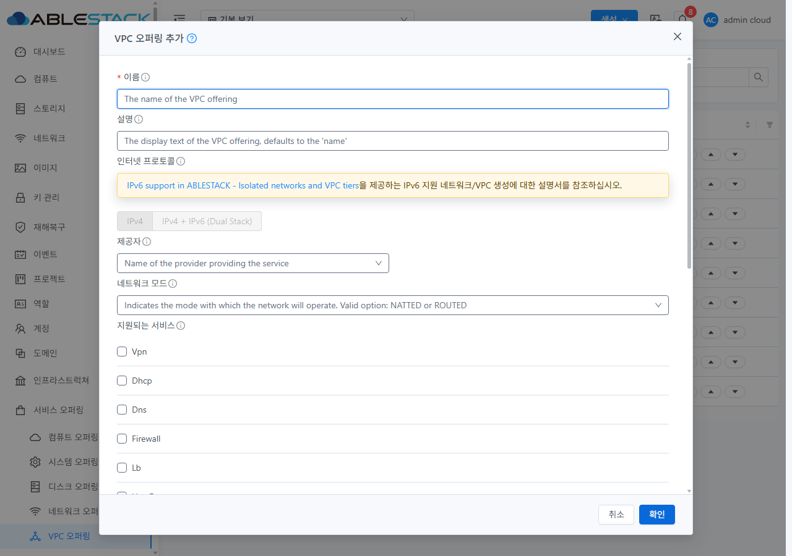
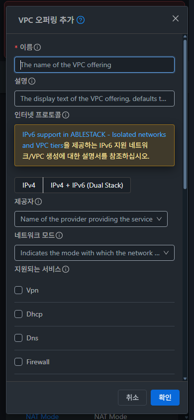

<!--
 Licensed to the Apache Software Foundation (ASF) under one
 or more contributor license agreements.  See the NOTICE file
 distributed with this work for additional information
 regarding copyright ownership.  The ASF licenses this file
 to you under the Apache License, Version 2.0 (the
 "License"); you may not use this file except in compliance
 with the License.  You may obtain a copy of the License at

   http://www.apache.org/licenses/LICENSE-2.0

 Unless required by applicable law or agreed to in writing,
 software distributed under the License is distributed on an
 "AS IS" BASIS, WITHOUT WARRANTIES OR CONDITIONS OF ANY
 KIND, either express or implied.  See the License for the
 specific language governing permissions and limitations
 under the License.
 -->

# #1658 VPC·VPC 오퍼링 VM 표준 UI 통합 검증

상위 [Epic #1650](https://github.com/ablecloud-team/ablestack-cloud/issues/1650),
누적 [Draft PR #1660](https://github.com/ablecloud-team/ablestack-cloud/pull/1660),
브랜치 `dhslove/epic-1650-vpc`.
제품 소스 `af129880b21c066ea19d105231288e049a6ca24c`, 기준 `e0d33060bcbc8e639791bdcee1dbf4732fa1a690`.

**#1658의 채택 범위 구현·31/32 배포·UI 및 VM 표준 스타일 검증·전용 자원 정리를 완료했다.**
VM 공통 화면과 MoldDialog를 재사용하고 VPC 전용 대상 문맥, 탭 URL, 표 스크롤,
단일 제출, 오류 후 입력/기존 행 보존, 선택 팝업 Escape와 포커스 복귀를 보완했다.
집중455개 테스트·변경17개 JS/Vue lint·UI build를 통과했다.
전체 UI의 기존13개 실패 및 실환경 미실행 범위는 아래에 구분한다.

## 설계·범위와 최종 변경

[실환경 설계](DESIGN.ko.md)는 기존 공통 Breadcrumb/ListView/InfoCard/ResourceView와
MoldDialog/MoldDialogActions를 재사용한다. #1212/#1213의 공통 프레임을 별도로 구현하거나 두 이슈를 종료하지 않는다.
VM 실제 목록·상세·편집·다크 화면은 읽기 전용으로 비교했다.

- VPC 전용 raw modal과 정적 경로 인라인 폼을 공통 중앙 대화상자로 연결했다.
- 편집·상태·삭제·ACL 교체에 대상 이름/UUID/owner/Zone/상위 VPC를 표시한다. 신규 생성에는 목록 첫 항목을 대상처럼 표시하지 않는다.
- 정적 경로/태그/ACL의 단일 제출, 실제 거부·job 실패 때 입력 보존, 늦은 응답의 문맥 가드를 보완했다.
- VPC·오퍼링·게이트웨이 탭은 router URL/뒤로·앞으로 이동과 조건부 탭 fallback을 사용한다.
- 게이트웨이 breadcrumb에 상위 VPC와 `tab=pgw` 복귀를 추가했다.
- 탭 도구모음과 표를 정리하고 게이트웨이·정적 경로 표의 최소 폭760px 및 내부 가로 스크롤을 적용했다.
- VpcDialog는 MoldDialog를 감싸 속성·slot·Footer 주입을 전달한다. Select가 처리한 Escape가 같은 이벤트로 상위 창까지 닫지 않게 하고 유효한 원래 trigger로 포커스를 반환한다.
- 오퍼링 추가는 lg(960px), 일반 폼은 md(720px)를 사용한다. 지원 서비스 목록의 별도 세로 스크롤을 제거하고 공통 Body가 스크롤을 소유한다.
- 실환경에서 발견한 숨김 Footer의 빈 API/번역 키 참조, 설치된 Alert에서 미지원 action slot, 목록 오류 문구 중복을 같은 범위에서 수정했다.

## 여섯 영역의 VM 비교 행렬

| 영역 | VM 공통 기반과 차이 | 적용·검증 증거 |
| --- | --- | --- |
| Breadcrumb | 공통 높이·간격·갱신/작업 구조 유지. 게이트웨이는 부모 맥락 부족 | Breadcrumb.vue의 부모 VPC·pgw query. 실제 부모 이동/브라우저 앞뒤 이동과 긴 이름 확인 |
| 목록 | SearchView/ListView/선택·열·페이지 재사용 | VPC 검색2건/없는 검색0건, CIDR 열 숨김 후 복원, 전용 VPC 선택, 503 때 기존 행 보존. 오퍼링 상태·관련 VPC 링크 확인 |
| 상세 | InfoCard/DetailsTab의 UUID/owner/Zone·관련 링크 유지 | API의 CIDR/DNS/MTU/MAC/오퍼링과 편집 전후 대조. 조회 중 카드 유지 |
| 탭 | 수동 history 대신 router 계약 적용 | VPC pgw/staticroutes, 게이트웨이 static.routes, 오퍼링 이벤트 전환. 잘못된 조건부 탭 fallback. query/앞뒤 이동 |
| 콘텐츠 | compact 도구모음, 표·페이지 정렬, 명시적 재시도 | 모바일 표296/760px 실측, IP·넷마스크 열 가로 스크롤 접근. 503 후 기존 행/재시도와 정상·빈 상태 구분 |
| 대화상자 | 공통 Mold frame과 Actions 재사용 | 아래 업무별 기록. 중앙/고정 Header·Footer/Body scroll, 긴 UUID/한국어, Escape/Tab/Ctrl+Enter/포커스·선택 popup |

## 업무 대화상자별 추적

| 업무 경로 | 컴포넌트·변경 이유 | 이번 실행 수준 |
| --- | --- | --- |
| VPC 생성 | CreateVpc/VpcDialog; 후보·입력·접수 계약 유지 | 양쪽 실제 UI start=false 생성, 실제 job/자원 대조. 31/32 설계 API 생성. 조건부 제공자 분기는 #1657 재사용 |
| VPC 편집 | AutogenView/VpcActionContext; 대상 문맥·Footer | 양쪽 실제 이름/설명 편집, DNS·MTU1500·MAC=true·owner/CIDR/오퍼링 보존 |
| VPC 재시작 | RestartVpc; 동일 어댑터 | 31 창 열기·닫기/대상·Live Patch 비활성/고정 Footer 확인. 이번 재시작 POST 없음. #1655의 단일·일괄/옵션·실패 결과 재사용 |
| VPC 마이그레이션 | MigrateVpc; 동일 어댑터 | 31 창 열기·닫기/서비스·대상·CIDR/DNS·PG/경로 보유 시 제외와 비활성 제출 확인. 이동/재개 POST 없음. #1656 실증 재사용 |
| VPC 삭제 | AutogenView/VpcActionContext; 대상 확인과 위험 액션 | 최종 배포에서 양쪽 UI 전용 VPC 삭제·실제 jobstatus=1·목록 소멸 확인. 설계 VPC는 정상 API로 별도 정리 |
| 게이트웨이 생성 | PrivateGatewayCreate/VpcDialog; 고정 Footer·Body scroll | 31 데스크톱/390 다크 위·아래/ACL popup. 기본 default_deny와 Escape 두 단계 확인. 실제 생성은 양쪽 설계 API, 기존 #1654 충돌/오류 시험 미반복 |
| 게이트웨이 ACL 교체 | AutogenView; 부모·대상 문맥 | 31 전용 빈 규칙 ACL로 실제 교체, job/최종 ACL 대조. 공통 ACL 규칙/통신 시험 없음 |
| 게이트웨이 삭제 | AutogenView; 대상 확인 | 최종 배포에서 양쪽 실제 UI 삭제·jobstatus=1·자원 소멸. 32는 경로·태그를 먼저 UI로 정리 |
| 정적 경로 추가 | StaticRoutesTab/VpcDialog; 인라인→표준 폼 | 양쪽 VPC+nexthop의 실제 CIDR431·보존·수정 생성. 32 gatewayid 생성의 nexthop/vpcid 미전송. 각 실제 job/행 대조 |
| 경로 태그 | StaticRoutesTab/VpcDialog; 고정 닫기·busy·오류 보존 | 양쪽 실제 태그 생성. 32 최초 key 포커스·빈 검증 후 첫 오류 필드·Ctrl+Enter 1 POST·성공 chip·닫기 후 trigger 복귀 |
| VPC ACL 목록 생성 | VpcTab/VpcDialog; 표준 폼·단일 제출 | 31 전용 빈 규칙 ACL 실제 생성. 규칙 CRUD·패킷 회귀는 재사용 |
| 오퍼링 생성·복제 | Add/CloneVpcOffering + AutogenView/VpcDialog; lg/md·단일 scroll | 양쪽 실제 생성·복제. 32는 응답 유실 후 같은 customjobid 재조회로 복구하고 create 추가 POST0. Default 복제의 LB 제공자2개와 conserve 값 대조 |
| 오퍼링 편집·상태·접근·삭제 | AutogenView/UpdateOfferingAccess; 대상/오류/고정 Footer | 양쪽 실제 이름·설명/Disabled→Enabled/공개 유지·현재 Zone 한정. 양쪽 복제본 UI 삭제 및 jobstatus=1, 신규본은 정상 API 정리 |

Tier/VPN 진입점도 같은 어댑터 import로 통일했고 기존 집중 테스트를 실행했다.
이번에 Tier/VM/VPN·공통 ACL/NAT/PF/LB 패킷을 새로 배포하거나 기존 네트워크 회귀를 다시 합산하지 않았다.

## 실환경 실행과 판정

31은 GFS2 SharedMountPoint, 32는 RBD이다. 저장소 API로 확인했으며 스토리지 드라이버 시험으로 확대하지 않았다.
전용 prefix `qa-vpc1658`의 VPC·게이트웨이만 설계 API로 생성했다. VPC는 `start=false`, 시험 라우터0이다.
UI 요청은 실제 Network에서 관찰한 mutation만 집계하고 모든 접수 job을 실제 queryAsyncJobResult 및 자원 조회와 대조했다.
오퍼링 복제 receipt의 숫자 내부 id는 최종 job/UUID로 다시 대조했다.

| 클러스터 | 관찰된 업무 UI POST | 최종 성공 job | 실제 CIDR431 | 동일 요청 ID로 응답 유실 복구 |
| --- | ---: | ---: | ---: | ---: |
| 31 GFS2 | 13 | 12 | 1 | 0 |
| 32 RBD | 12 | 11 | 1 | 1 |

복구1건은 성공11건에 포함하며 별도 성공으로 더하지 않는다.
[31 UI/API 대조](evidence/31-ui-api-oracle.json), [32 UI/API 대조](evidence/32-ui-api-oracle.json)에
실제 요청·접수·terminal job·최종 자원과 생성/복제/태그/VPC 편집의 계약 검사를 연결했다.
설계용 VPC·게이트웨이 생성4 jobs와 아래 UI 정리8 jobs/API 정리7 jobs는 이25 POST에 합산하지 않는다.

32의 응답 유실은 실제 서버 처리 후 HTTP200 응답을 CDP에서 보류·중단해 유발했다.
화면의 미확정 상태에서 같은 customjobid를 재조회하여 단일 실제 생성의 완료를 확인했다.
장애 주입 중 함께 보류된 종료 준비 조회가 일시 알림을 만들었으나 가로채기를 해제하고 정상 상태를 복원했다.
이는 백엔드 장애 또는 추가 제품 수정의 근거로 사용하지 않았다.

최초 CIDR431 한 번은 Network 재활성화 전이라 POST 집계에서 제외했다. 조회503은 CDP의 전용 XHR 장애 주입이며
실제 서버 성공으로 계산하지 않는다. 보류한 추가 조회를 정상 재개하고 가로채기를 제거한 뒤 복구를 확인했다.
오퍼링 생성창의 빈 API 참조와 보이지 않는 재시도는 중간 배포에서 재현한 결함이다.
최종 수정·재배포 후 정상 생성창, 실제 설치된 Alert의 재시도, 렌더 예외0을 별도 증거로 확인했다.

## UI 크기·테마·상태 증거

[화면 행렬](evidence/ui-style-matrix.json)은 채택68개 관찰·추가7개 참조와 제외7개 사유를 기록한다.
각 항목에는 실제 배포 소스·URL·테마·viewport·modal/Body 치수와 원본 캡처를 연결했다.
이미지는 캡처 바이트 그대로 보존하고 실제 JPEG/PNG 형식에 맞춰 확장자만 정리했다.

| 대표 화면 | 환경 행렬 | 확인 |
| --- | --- | --- |
| 정적 경로 추가 | 31/32 × 390×844·768×900·1280×900 × light/dark =12 | 중앙 정렬·화면 내 크기·Body 가로 넘침0 |
| VPC 오퍼링 추가 | 같은 환경12조합 | 중앙 정렬·lg 폭·고정 Footer·지원 서비스 내부 세로 스크롤0 |
| 최종 배포 재확인 | 31 추가1280 light /32 추가390 dark, 삭제 창·오류·일괄 대상·포커스·빈 목록 | 최신 app bundle의 렌더 예외0, 작업 후 modal0 |

31 게이트웨이 조회503은 기존 행을 유지한 상태에서 보이는 재시도를 실제 클릭하여 복구했다.
32 정적 경로 조회503은 두 행과 재시도를 유지했고 장애 제거 후 자동 복구했다.
32 수동 클릭 성공은 주장하지 않는다. 설치된 실제 Alert의 양쪽 탭 버튼 클릭은 집중 테스트로 확인했다.
VPC 목록503의 중복 상태 문구0·오류 Alert1·기존 시험 행2 유지와 자동 복구도 최종 배포에서 확인했다.
[31 재시도](evidence/31-final-lookup-retry.json), [32 재시도/한계](evidence/32-final-lookup-retry.json),
[목록 오류](evidence/31-final-list-retry.json), [포커스](evidence/31-final-context-focus.json),
[팝업·관련 VPC·태그](evidence/live-ui-observations.json), [렌더 예외](evidence/final-render-errors.json).

정적 경로 대화상자의 31/32 × 390×844/768×900/1280×900 × light/dark 12조합은 370c870에서 실측·비교했다.
오퍼링12조합은 090492e에서 실측했다. 이후 af12988은 비활성 Footer의 번역 키 fallback 및 실제 i18n 테스트 변경이다.
정적 경로 행렬 이후에는 숨김 Footer 참조 방어·오류 재시도 slot·중복 문구·context-menu 포커스도 보완했다.
일반 정상 대화상자의 레이아웃·CSS 변경은 없다. 최종 배포에서도 위 주요 경로를 다시 확인했다.
이 행렬은 해당 화면의 조합이며 모든 업무 대화상자의 전 크기·테마 조합 PASS를 의미하지 않는다.
즉시 테마 전환은 실제 사용자 설정으로 수행했고 페이지를 다시 불러오기 전에 적용을 확인했다.
테스트 자동화에서 창 열기/크기 변경 직후 이전 프레임을 캡처한 파일은 최종 비교 증거에서 제외했다.

## 테스트·빌드·배포

- 집중 UI: 19 suites / **455 tests PASS**, 변경17개 JS/Vue lint 통과.
- 실제 generic Footer를 소스에서 컴파일해 API 없는 비활성 작업/삭제 상태를 렌더링하고, 설치된 Alert로 두 탭의 재시도 표시·클릭을 검증했다.
- 전체 UI는 baf250d에서 395 suites / 6,044 tests 중 389 suites / **6,031 PASS, 13 FAIL**(438.6초).
- 기존 #1657 기준선에서 실증한 동일13 이름·동일6파일이며 해당 파일 변경0이다. 후속 중복 문구·포커스·비활성 Footer i18n 방어 후 집중455·변경 lint를 재실행했다.
- 상세 수치와 이전 증거 연결은 [ui-test-summary.json](evidence/ui-test-summary.json). 전역 테스트 green을 주장하지 않는다.

최종 af12988의 UI build는 Node20.20.2/npm10.8.2와 legacy OpenSSL 옵션으로770.8초에 완료했다.
[build 결과](evidence/build-result.json), [집중 결과](evidence/unit-result.json),
[변경 lint](evidence/changed-file-lint.json)에 소스와 판정을 기록했다.

| 활성 webapp | 31 | 32 |
| --- | --- | --- |
| 배포 정적 파일 | 695개 /31,472,002 bytes | 동일 |
| 전체 manifest 해시 불일치 | 0 | 0 |
| `/client/` HTTP | 200 | 200 |
| WEB-INF·META-INF·설정·JAR·PID·기존 큰 이미지 | 보존 | 보존 |

활성 app은 `js/app.f0c9596d.js`, index SHA256은
`2642666ee6dde4ef313b3e419a5ab522f9f571841ecdd845b8801e98da17c5bf`이다.
양쪽 remote stage는 `/var/tmp/vpc1658-20261114-224422`이며 교체 전 정적 자산 백업을 유지한다.
백업 SHA256은 31 `9e31798a07640b176330d2a9e3dd74ea284ef0788c3d1e3ac9c7f40ecd4e76e1`,
32 `5828394d368a240f63872eca90a9dde9b82599c2dd804dcd499ee2a304d87519`이다.
기존 VPC 접수/복구 및 FTCTL `blockingLoadingState`·`fetchSyncProgress`·`extractJobId` marker도 보존했다.
[31 배포](evidence/31-deployment.json), [32 배포](evidence/32-deployment.json),
[31 활성 검증](evidence/31-active-deployment-verification.json), [32 활성 검증](evidence/32-active-deployment-verification.json).

UI만 WSL ext4에서 빌드하고 정적 allowlist만 반영했다. webapp 루트 삭제/교체, rsync --delete, 서비스 재시작은 없다.
서버·DB·호스트·Java·Maven·관리 JAR·qemu·RPM 소스와 배포는 변경하지 않았다. 전체 Cloud 빌드/Release Actions를 시작하지 않았다.

## 정리·기존 자원 보존

전용 객체14개와 경로 태그를 모두 정리했다. 최종 배포 UI의 삭제8 POST(31=3,32=5)와
정상 API의 나머지7개 삭제가 각각 실제 jobstatus=1이다. 32 UI5건에는 태그 삭제1건이 포함된다.
양쪽 VPC·게이트웨이·복제 오퍼링 삭제는 UI에서 수행했다. 32 gateway 경로도 UI에서 먼저 삭제했다.
수동 DB 정리 없이 전체 UUID와 태그 부재를 확인했다.
[31 UI 정리](evidence/31-ui-cleanup-oracle.json), [32 UI 정리](evidence/32-ui-cleanup-oracle.json),
[31 API 정리](evidence/31-cleanup.json), [32 API 정리](evidence/32-cleanup.json).

| 기존 API 보기 | 31 전/후 | 32 전/후 |
| --- | --- | --- |
| VPC | 2/2 | 1/1 |
| 게이트웨이 | 0/0 | 0/0 |
| 정적 경로 | 0/0 | 0/0 |
| 네트워크 | 31/31 | 16/16 |
| ACL 목록 | 4/4 | 2/2 |
| 물리 네트워크 | 2/2 | 2/2 |
| Zone | 1/1 | 1/1 |
| VPC 오퍼링 | 7/7 | 7/7 |
| 라우터 | 20/20 | 10/10 |
| VM | 132/132 | 58/58 |
| 계정 | 26/26 | 22/22 |
| 프로젝트 | 7/7 | 5/5 |

12종 UUID·선택 주요 설정·계정 사용량 차이0이다.
네트워크 오퍼링33/24개의 UUID/설정, 물리망 제공자·traffic·VR element 설정, BGP peer/AS0을 별도 대조했다.
숨김 시험 VPC/네트워크도 남지 않았고 별도 FTCTL 작업 트리의 수정3개 해시는 동일하다.
[31 보존](evidence/31-preservation.json), [32 보존](evidence/32-preservation.json),
[31 추가 보존](evidence/31-extra-preservation.json), [32 추가 보존](evidence/32-extra-preservation.json),
[FTCTL 보존](evidence/ftctl-worktree-preservation.json).

UI 시험 prefix 검색0과 기준 목록 VPC2/1·오퍼링7/7도 확인했다.
양쪽 화면을 기본 보기·light·1680×841·열린 창0으로 복원하고 Fetch 장애 주입·캐시/viewport override를 해제했다.
[브라우저 정리](evidence/browser-session-cleanup.json), [prefix0](evidence/ui-cleanup-prefix.json).

비교는 새 기준선의 12종 기본 API 보기에서 UUID 집합과 선택 주요 설정 및 계정 사용량이다.
모든 프로젝트의 과거 DB 행·호스트 파일 전수 검증으로 확대하지 않는다.
배열의 제공자 순서만 달라진 경우에는 정규화한 의미 값이 같은지 별도 기록한다.
정리 도중 이미 삭제된 경로의 ID 지정 조회431은 전체 live 목록의 UUID 비교로 부재를 다시 확인했다.
이 검증 스크립트의 조회 조건을 수정했으며 제품 범위 확대·추가 mutation·DB 변경은 없다.

## 범위 밖·후속과 한계

- #1659의 next-hop 경로 `privategw/undefined` 링크는 이번에도 관찰했으며 수정하지 않았다. 별도 이슈 생성 없음.
- 외부 NSX/Netris/Netscaler, 실제 BGP peer/AS·IPv6·ROUTED 풀, 다른 물리망·MTU 특례, 모든 권한/프로젝트/도메인 조합은 이번 실환경 시험 대상이 아니다.
- 오퍼링 provider UI/기존 집중 fixture가 외부 장비 실행을 증명하지 않는다. 실제 트래픽/무중단/라우터 시작/이중화 전환·migration/resume 성공은 선행 보고의 제한과 구분한다.
- #1651~#1657의 채택 결과와 #1554/#1569·#1600/#1601/#1602/#1610/#1611/#1613의 완료 범위를 재사용했다.
- #1212/#1213은 Open 상태를 유지한다. Epic은 #1658 완료 후8/9이며 #1659가 남는다. PR은 Draft·미병합이다.
- 전체 Cloud 빌드·전역 License/Lint/전체 UI green 또는 Epic 전체 완료를 주장하지 않는다.
