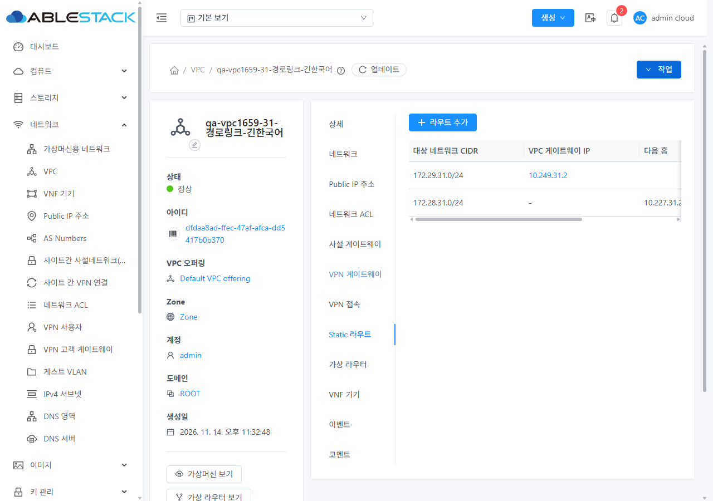
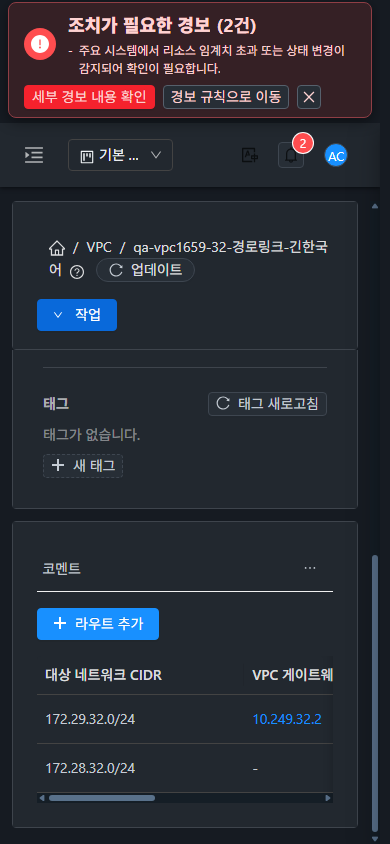

<!--
Licensed to the Apache Software Foundation (ASF) under one
or more contributor license agreements.  See the NOTICE file
distributed with this work for additional information
regarding copyright ownership.  The ASF licenses this file
to you under the Apache License, Version 2.0 (the
"License"); you may not use this file except in compliance
with the License.  You may obtain a copy of the License at

  http://www.apache.org/licenses/LICENSE-2.0

Unless required by applicable law or agreed to in writing,
software distributed under the License is distributed on an
"AS IS" BASIS, WITHOUT WARRANTIES OR CONDITIONS OF ANY
KIND, either express or implied.  See the License for the
specific language governing permissions and limitations
under the License.
-->

# #1659 next-hop 정적 경로 링크 수정·실환경 검증

[이슈 #1659](https://github.com/ablecloud-team/ablestack-cloud/issues/1659) ·
[Epic #1650](https://github.com/ablecloud-team/ablestack-cloud/issues/1650) ·
[누적 Draft PR #1660](https://github.com/ablecloud-team/ablestack-cloud/pull/1660).
브랜치 `dhslove/epic-1650-vpc`, 제품 `222adb1674d90af3d4ef22098703752490033dcb`.
[설계](DESIGN.ko.md)의 채택 범위만 구현·배포·검증했다.

## 결과와 변경 범위

next-hop 경로는 게이트웨이 ID/IP가 없는 정상 응답이다.
이 셀의 빈 `#/privategw/undefined` 링크를 비대화형 `-`로 바꿨다.
게이트웨이 ID/IP가 모두 공백 아닌 문자열일 때만 기존 IP 링크를 유지한다.
다음 홉·CIDR·생성/삭제·태그·비동기 API 계약은 유지했다.

제품 변경은 `StaticRoutesTab.vue`의 셀 조건과 predicate뿐이다.
컬럼/색/폭/라벨·breadcrumb/목록/상세/탭/폼을 다시 설계하지 않았다.
VM 공통 표와 #1658에서 적용한 최소 폭760px·내부 가로 스크롤을 재사용했다.
일반 네트워크·공통 ACL/NAT/PF/LB/VPN 회귀나 외부 제공자·BGP/IPv6·라우터/패킷 시험을 추가하지 않았다.
별도 이슈 생성 없음. #1212/#1213은 Open을 유지한다.

## 실환경 설계와 UI→API→최종 상태

31 GFS2·32 RBD 각각 전용 VPC(start=false)·게이트웨이에서 기존 배포 UI로 두 경로를 생성해 결함을 재현했다.
서로 다른 CIDR/IP/VLAN을 사용했고 전용 라우터0이다.
양쪽 next-hop 셀에서 빈 `#/privategw/undefined`와 tabIndex0을 관찰했다.
gatewayid 방식은 정확한 IP·게이트웨이 상세 링크가 있었다.
[31 수정 전 DOM](evidence/31-before-ui.json), [32 수정 전 DOM](evidence/32-before-ui.json).

| 단계 | 31 | 32 | 판정 |
| --- | --- | --- | --- |
| UI next-hop 생성 | vpcid+nexthop+CIDR | 동일 | 각각1 POST·terminal job1·Active, gateway 필드 없음 |
| UI gateway 생성 | gatewayid+CIDR | 동일 | 각각1 POST·terminal job1·Active, gateway ID/IP 일치 |
| 최종 배포 조회 | 전용 경로2개 | 전용 경로2개 | next-hop 셀 `-`/링크0, 정상 게이트웨이 링크1 |
| 최종 배포 UI 삭제 | 전용 경로2개 | 전용 경로2개 | 각각2 POST·terminal job1·최종 경로0 |
| 정상 API 정리 | 게이트웨이·VPC | 동일 | 각각2 terminal job1·최종 부재 |

생성4 POST는 **수정 전 실증 단계**, 삭제4 POST는 **최종 배포 단계**이다.
생성 API 변경이 없는 이번 셀 수정에서 실행 시점을 구분하며 모두 최종 배포에서 생성한 것처럼 집계하지 않는다.
[31 생성 대조](evidence/31-design-ui-api-oracle.json), [32 생성 대조](evidence/32-design-ui-api-oracle.json),
[31 삭제 대조](evidence/31-ui-delete-oracle.json), [32 삭제 대조](evidence/32-ui-delete-oracle.json),
[31 정리](evidence/31-api-cleanup.json), [32 정리](evidence/32-api-cleanup.json).

## UI·키보드·VM 스타일

최종 소스의 양쪽 실제 VPC 표에서 두 행을 함께 검사했다.
next-hop 행은 `-`와 원래 다음 홉을 표시하고 gateway 셀에 a/button/tabindex가 없다.
gateway 행은 정확한 IP와 `#/privategw/<실제 UUID>`를 표시한다.
실제 Tab 순회에 빈 링크가 없고 게이트웨이 링크의 Enter는 정확한 게이트웨이 상세로 이동한다.
브라우저 뒤로 이동 후 표의 경로와 탭 문맥을 확인했다.
[최종 DOM](evidence/ui-final-observations.json), [키보드](evidence/keyboard.json).

31/32 × 390×844·768×900·1280×900 × light/dark의 **12조합**에서 두 경로 행을 확인했다.
테마는 실제 페이지 스타일 설정으로 즉시 전환했다.
`-`의 표준 텍스트 색과 배경, 게이트웨이 링크의 값·색, 표 내부 가로 스크롤/화면 너비를 기록했다.
모바일의 최소 폭760px 표는 내부 가로 이동으로 IP·다음 홉·작업 열에 접근한다.
31은 가로 wheel, 32는 작업 열의 키보드 포커스로 실제 scrollLeft340/398을 확인했다.
표 컨테이너 폭은390px 화면에서296px이며 원래760px 열 폭을 유지한다.
12조합은 이 정적 경로 표의 조합이며 다른 업무 대화상자의 전 조합 시험을 의미하지 않는다.
[스타일 행렬](evidence/style-matrix.json), [가로 이동](evidence/mobile-scroll.json), [대체 텍스트 대비](evidence/style-checks.json).
테마는1280px의 실제 설정에서 전환한 뒤 각 크기를 검사했다. 메뉴/레이아웃 전환 중 캡처는 최종12개로 대체했다.
VM 비교 기준은 [#1658 보고서](../vpc-1658-20261114/README.ko.md)의 실제 VM 참조를 재사용한다.

## 테스트·빌드·정적 배포

- 수정 전 실제 컴포넌트·Ant Table·Vue Router 테스트: 누락/빈/null/공백8개 실패, 정상 링크2개 통과.
- 수정 후 새10개 포함 **20 suites/465 tests PASS**, 변경2개 JS/Vue lint PASS.
- 전체 UI는 이번 작은 셀 수정에서 재실행하지 않았다. #1658의 baf250d 실행은6,031 PASS/기존13 FAIL이었다. 전역 green을 주장하지 않는다.
- Node `v20.20.2`, npm `10.8.2`, WSL ext4 UI build **714.7초 PASS**, 소스 UI clean.
- [집중·기준선 비교](evidence/checks-summary.json), [집중 결과](evidence/unit-result.json), [빌드](evidence/build-result.json).

양쪽 `/usr/share/cloudstack-management/webapp`에 정적 allowlist만 반영했다.
활성 app `js/app.6f2f3c3d.js`, index SHA256 `89aacc3e9ca657ee1f6e82aae8d388bfaef128a5c5d386cfc139a6829fb24411`.
manifest 전체 파일 해시·/client/ HTTP200·WEB-INF/META-INF·설정·JAR·PID·기존 큰 이미지 보존을 확인했다.
새 hasGatewayLink와 기존 VPC/FTCTL marker를 활성 번들에서 확인했다.
[31 배포](evidence/31-deployment.json), [32 배포](evidence/32-deployment.json),
[31 활성 검증](evidence/31-active-deployment-verification.json), [32 활성 검증](evidence/32-active-deployment-verification.json).
배포별 원격 stage·백업 SHA256은 각 receipt에 기록했고 WSL 백업을 유지한다.
첫31 배포 시도는 보조 스크립트에 남은 이전 이슈 디렉터리 제한으로 백업 전 거부됐다.
보조 스크립트의 prefix만 수정한 뒤 재개했으며 최초 정적 적용0·제품 소스 변경0이다.
[배포 시도 기록](evidence/deployment-attempt-note.json).
webapp 루트 삭제/교체·rsync --delete·서비스 재시작·서버/JAR/DB/호스트 변경은 없다.
Maven·전체 Cloud·Release Actions·qemu/RPM 빌드는 시작하지 않았다.

## 정리와 기존 자원 보존

전용 경로4개·게이트웨이2개·VPC2개, **총8개**를 정상 경로로 정리했다.
전용 라우터·네트워크·태그는 생성하지 않았다.
기존12종 기본 API 보기의 UUID·선택 주요 설정·계정 사용량을 비교해 차이0을 확인했다.

| API 보기 | 31 전/후 | 32 전/후 |
| --- | --- | --- |
| listVPCs | 2/2 | 1/1 |
| listPrivateGateways | 0/0 | 0/0 |
| listStaticRoutes | 0/0 | 0/0 |
| listNetworks | 31/31 | 16/16 |
| listNetworkACLLists | 4/4 | 2/2 |
| listPhysicalNetworks | 2/2 | 2/2 |
| listZones | 1/1 | 1/1 |
| listVPCOfferings | 7/7 | 7/7 |
| listRouters | 20/20 | 10/10 |
| listVirtualMachines | 132/132 | 58/58 |
| listAccounts | 26/26 | 22/22 |
| listProjects | 7/7 | 5/5 |

[31 보존](evidence/31-preservation.json), [32 보존](evidence/32-preservation.json),
[별도 FTCTL 수정3파일 해시 보존](evidence/ftctl-worktree-preservation.json).
이 비교는 기본 API 범위이며 모든 프로젝트 과거 DB/호스트 파일 전수 검사로 확대하지 않는다.
배열의 순서만 다른 경우 정규화한 의미 값을 비교한다.
브라우저는 원래 테마·viewport로 복원하고 임시 캐시/viewport override를 제거했다.
양쪽 빈 표와 전용 prefix0도 확인했다. [브라우저 정리](evidence/browser-cleanup.json).

## 추적 상태

이번 #1659의 완료 기준6개를 실증 근거와 연결해 Completed로 종료한다.
Epic은 하위9/9 구현·배포·집중 검증 완료로 갱신하며 Epic 자체는 PR 검토·병합 전 Open을 유지한다.
누적 PR #1660은 최신 소스·검증 증적으로 갱신하고 Draft·미병합을 유지한다.
병합/전역 테스트/전체 Cloud 빌드 완료를 주장하지 않는다.
